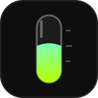
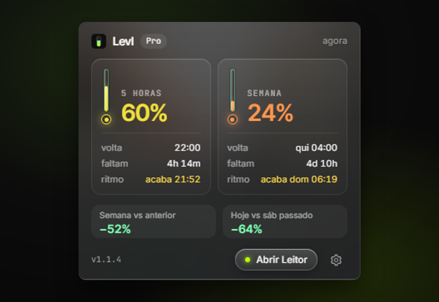

<p align="center">
  
</p>

<h1 align="center">Levl</h1>

<p align="center">
  <b>Um termômetro de vidro na sua área de trabalho que mostra quanto ainda resta do seu plano do Claude.</b><br>
  Windows · grátis · código aberto para uso não comercial · <i>by JHON</i>
</p>

<p align="center">
  
</p>

---

## O que ele faz

- **Termômetro na tela:** um tubo fino que fica sempre à vista e mostra o limite de **5 horas** do Claude. Ele começa cheio e vai esvaziando, mudando de cor do verde para o amarelo e depois para o vermelho.
- **Painel ao clicar:** mostra os limites de **5 horas** e da **semana**, a hora em que cada um volta, quanto tempo falta e a previsão de quando vai acabar no seu ritmo atual.
- **"Esgotado":** quando o limite acaba, o Levl avisa até ele voltar.
- **Leitor:**
  - compara o seu consumo com o da semana passada e com o mesmo dia da semana anterior;
  - lista os projetos que mais gastaram;
  - dá dicas para economizar;
  - tem um botão para o próprio Claude analisar o seu uso e sugerir ferramentas.
- **Avisos do Windows:** com 20% restantes, quando o limite volta, um resumo diário e um alerta de ritmo acima do normal.
- **Do seu jeito:**
  - três visuais (Linha, Grafite e Névoa), transparência e tamanho ajustáveis;
  - arraste para qualquer borda da tela: ele fica horizontal ou vertical;
  - abre junto com o Windows, no mesmo lugar;
  - atalhos: `Ctrl+Alt+L` mostra e esconde; `Ctrl+Alt+K` deixa os cliques atravessarem o tubo.
- **Atualiza sozinho:** quando sai uma versão nova, aparece "Atualizar" no painel.

## Do que você precisa

| Item | Para quê | Custo |
|---|---|---|
| Windows 11 (o Windows 10 funciona, mas sem o efeito de vidro) | rodar o Levl | — |
| Plano **Claude Pro ou Max** | é o plano que o Levl mede | pago (assinatura da Anthropic) |
| **Claude Code** instalado e com login feito | o Levl lê o consumo a partir desse login | grátis com o plano |
| Git e Node.js LTS | só se for montar a partir do código | grátis |
| Conta no GitHub | opcional: só para guardar a sua cópia | grátis |

> O Levl em si é grátis. A única coisa paga é o plano do Claude, que é justamente o que ele mede.

## Opção 1: instalar pronto (1 minuto)

1. Baixe o `Levl-Setup-<versão>.exe` mais recente em **[Releases](https://github.com/Jhons-neural/levl-releases/releases/latest)**.
2. Abra o arquivo. Se o Windows mostrar "O Windows protegeu o computador", clique em **Mais informações** e depois em **Executar assim mesmo**. O aviso aparece porque o instalador não tem certificado pago; o código está todo aqui para você conferir.
3. Pronto: o termômetro aparece no canto da tela. Se ele mostrar "abra o Claude Code para atualizar", abra o Claude Code uma vez e faça login.

## Opção 2: montar do zero com o Claude Code

O Claude Code instala o que falta, baixa este repositório, roda os testes, gera o instalador e instala o Levl para você. Você só faz o que a máquina não pode fazer sozinha, como o login.

1. **Instale o Claude Code** (só uma vez). Abra o **PowerShell** e rode:
   ```powershell
   irm https://claude.ai/install.ps1 | iex
   ```
2. **Faça login:** no PowerShell, digite `claude`. O navegador abre: entre com a sua conta do Claude (Pro ou Max) e autorize.
3. **Cole o prompt:** abra o arquivo **[PROMPT.md](PROMPT.md)**, copie o bloco inteiro e cole no Claude Code. Ele explica cada passo e pede a sua confirmação antes de instalar qualquer coisa.

### Ou, se você já programa

```powershell
git clone https://github.com/Jhons-neural/levl.git
cd levl
npm ci
npm test          # 67 testes
npm start         # roda sem instalar
npm run dist      # gera dist\Levl-Setup-<versão>.exe
```

## Privacidade: o que o Levl faz por baixo

- Ele lê o login que o próprio Claude Code salva no seu PC (`%USERPROFILE%\.claude\.credentials.json`). Só lê, nunca altera, e envia esse login **apenas** para `api.anthropic.com`.
- O consumo vem de um endereço da Anthropic que **não é oficial** (`/api/oauth/usage`). É o mesmo que o Claude Code usa, mas a Anthropic pode mudá-lo sem aviso. Se mudar, o Levl mostra o aviso e para de atualizar até sair uma versão nova.
- O **Leitor** lê os registros do Claude Code no seu PC (`%USERPROFILE%\.claude\projects`) e faz as contas localmente.
- O botão **"Analisar com o Claude"** envia ao Claude só números e nomes de pastas, nunca o seu código. Essa análise gasta um pouco do seu limite, e o Levl mostra quanto.
- As atualizações vêm do repositório oficial [`Jhons-neural/levl-releases`](https://github.com/Jhons-neural/levl-releases).

## Estrutura do projeto

```
src/
  main/            processo principal do Electron
    main.js        janelas, bandeja, atalhos, consultas e avisos
    sources/       de onde vêm os dados (claude.js)
    usage/         leitura dos registros, comparações, dicas e resumo
    analyze.js     análise com o Claude Code em segundo plano
    updates.js     atualização automática
  renderer/        telas: termômetro, painel, Leitor e configurações
  shared/          cor do líquido, textos de status e markdown seguro
test/              testes (node --test)
assets/ build/     ícones
```

Feito com Electron, JavaScript puro (sem framework), fontes Inter, Inter Tight e JetBrains Mono, e testes com `node:test`.

## Licença

**[PolyForm Noncommercial 1.0.0](LICENSE.md)**:
- você pode usar, estudar e adaptar o Levl para uso próprio ou de qualquer fim **não comercial**;
- você **não** pode vender o Levl nem uma versão modificada dele;
- os créditos são obrigatórios: mantenha a linha `Required Notice` do arquivo de licença.

Levl não é um produto da Anthropic. "Claude" é marca da Anthropic.

---

<p align="center">
  Criado por <b>JHON</b> · me segue no Instagram: <b>@SEU_ARROBA_AQUI</b> para mais ferramentas como esta.
</p>
