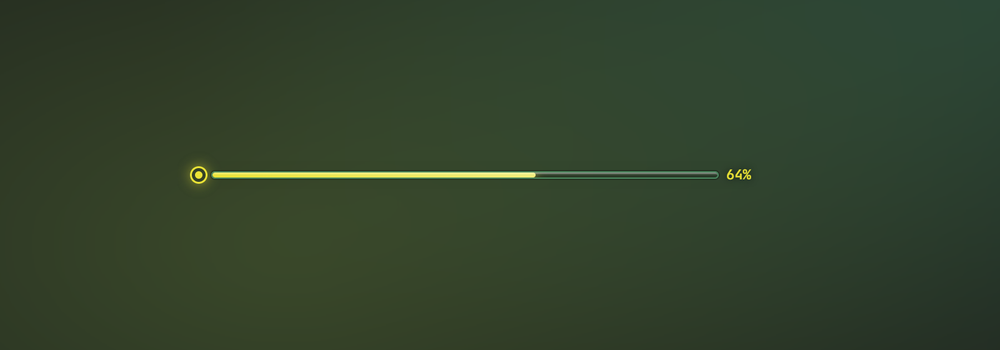
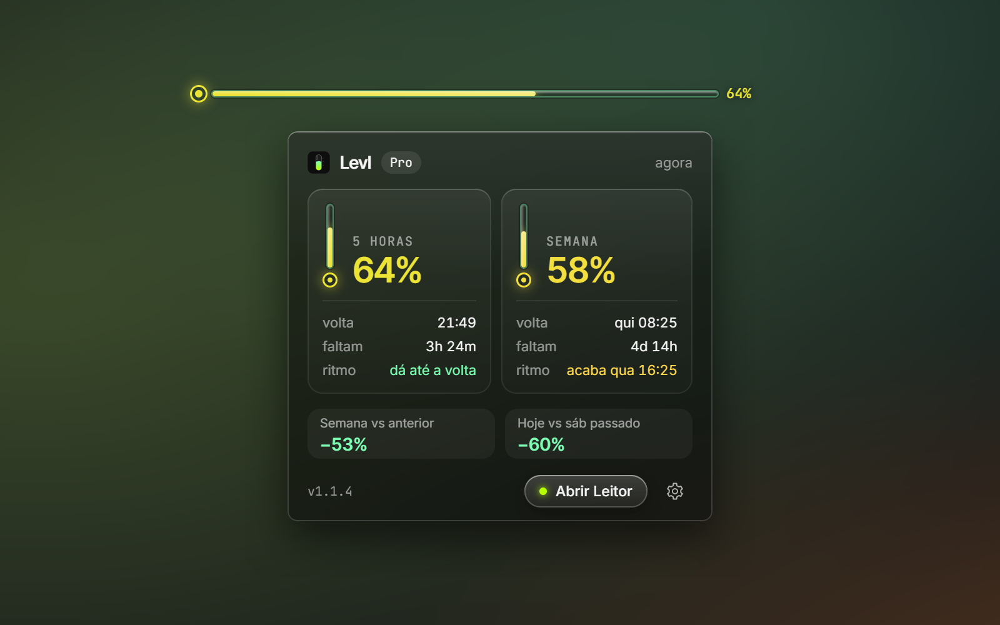
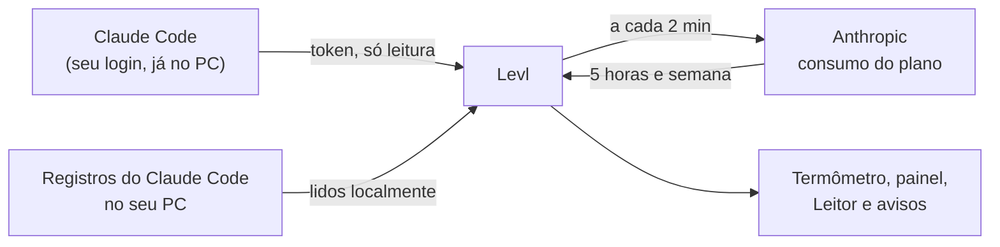

<p align="center">
  
</p>

<h1 align="center">Levl</h1>

<p align="center">
  <b>Um termômetro de vidro na sua área de trabalho que mostra quanto ainda resta do seu plano do Claude.</b><br>
  Windows · grátis · <i>by JHON</i> · <a href="https://instagram.com/jhon.comvc">@jhon.comvc</a>
</p>

<p align="center">
  
</p>

---

## Sumário

1. [Para que serve](#1-para-que-serve)
2. [O que ele faz](#2-o-que-ele-faz)
3. [Como funciona por dentro](#3-como-funciona-por-dentro)
4. [Do que você precisa](#4-do-que-você-precisa)
5. [Comece aqui: escolha um caminho](#5-comece-aqui-escolha-um-caminho)
   - [Caminho A: instalar pronto (1 minuto)](#caminho-a-instalar-pronto-1-minuto)
   - [Caminho B: montar com o Claude Code (o prompt)](#caminho-b-montar-com-o-claude-code-o-prompt)
   - [Caminho C: para quem programa](#caminho-c-para-quem-programa)
6. [Como usar no dia a dia](#6-como-usar-no-dia-a-dia)
7. [Problemas comuns](#7-problemas-comuns)
8. [Privacidade](#8-privacidade)
9. [Estrutura do projeto](#9-estrutura-do-projeto)
10. [Licença e créditos](#10-licença-e-créditos)

---

## 1. Para que serve

Quem usa o **Claude** e o **Claude Code** todo dia vive a mesma situação: você está no meio de uma tarefa importante e, de repente, o limite acaba. Aí vem a pergunta: *"volta quando?"*

O Levl resolve isso deixando o seu consumo **sempre à vista**, como o marcador de combustível de um carro:

- você sabe **quanto ainda resta** antes de começar uma tarefa grande;
- você sabe **quando o limite volta**, com hora e contagem regressiva;
- você vê se, **no seu ritmo atual**, o limite vai acabar antes de voltar;
- você descobre **quais projetos gastam mais** e recebe dicas para economizar.

**Objetivo:** usar o plano do Claude com controle. Nada de ser pego de surpresa e nada de deixar limite sobrando sem saber.

## 2. O que ele faz

<p align="center">
  
  <br><sub>Clicou no termômetro, abriu o painel.</sub>
</p>

| Recurso | O que é |
|---|---|
| 🌡️ **Termômetro na tela** | Um tubo fino de vidro, sempre visível, com o limite de **5 horas**. Começa cheio e vai esvaziando. O líquido muda de **verde** para **amarelo** e depois para **vermelho**. |
| 🪟 **Painel ao clicar** | Mostra os limites de **5 horas** e da **semana**: porcentagem restante, quando volta, quanto falta e a previsão de quando acaba no seu ritmo. |
| ⛔ **Esgotado** | Quando o limite acaba, aparece **"esgotado"** até ele voltar. |
| 📊 **Leitor** | Compara o seu consumo com a **semana passada** e com o **mesmo dia da semana anterior**, mostra os **projetos que mais gastaram** e dá **dicas rápidas** para economizar. |
| 🤖 **Analisar com o Claude** | Um botão em que o próprio Claude lê os seus números, explica o que pesa, sugere ações e procura ferramentas úteis no GitHub. |
| 🔔 **Avisos do Windows** | Com **20% restantes**, quando o limite **volta**, um **resumo diário** no horário que você escolher e um alerta de **ritmo acima do normal**. |
| 🎨 **Três visuais** | **Linha** (neon fino), **Grafite** (vidro escuro) e **Névoa** (vidro claro), mais transparência e tamanho ajustáveis. |
| ↔️ **Arraste para onde quiser** | Na borda de baixo ou de cima ele fica horizontal; nas laterais, vertical. Abre junto com o Windows, no mesmo lugar. |
| ⌨️ **Atalhos** | `Ctrl+Alt+L` mostra e esconde. `Ctrl+Alt+K` deixa o clique atravessar o tubo. |
| ⬆️ **Atualiza sozinho** | Quando sai uma versão nova, aparece **"Atualizar"** no painel: um clique e pronto. |

## 3. Como funciona por dentro



1. Quando você faz login no **Claude Code**, ele guarda o login no seu PC. O Levl **só lê** esse arquivo e nunca o altera.
2. A cada 2 minutos, o Levl pergunta à Anthropic quanto do seu plano já foi usado, no **limite de 5 horas** e no **limite semanal**.
3. Para o **Leitor**, ele lê os registros que o Claude Code salva no seu PC e calcula tudo **localmente**: comparações, projetos e dicas.
4. Tudo aparece no termômetro, no painel e nos avisos do Windows.

## 4. Do que você precisa

| Item | Para quê | Custo |
|---|---|---|
| **Windows 11** (o 10 funciona, mas sem o efeito de vidro) | rodar o Levl | — |
| Plano **Claude Pro ou Max** | é o plano que o Levl mede | pago (assinatura da Anthropic) |
| **Claude Code** com login feito | o Levl lê o consumo a partir desse login | incluso no plano |
| **Git** e **Node.js** | só nos caminhos B e C (o prompt instala para você) | grátis |
| Conta no **GitHub** | opcional: só se quiser guardar a sua cópia | grátis |

> 💡 O Levl é **100% grátis**. A única coisa paga é o plano do Claude, que é justamente o que ele mede.

## 5. Comece aqui: escolha um caminho

| Caminho | Para quem | O que você copia |
|---|---|---|
| **A · Instalar pronto** | quer só usar | nada: baixa e abre |
| **B · Montar com o Claude Code** | quer ver a IA montando tudo | **2 comandos** e **1 prompt** |
| **C · Para quem programa** | quer mexer no código | **4 comandos** |

---

### Caminho A: instalar pronto (1 minuto)

1. Baixe o **`Levl-Setup-<versão>.exe`** mais recente:
   👉 **https://github.com/Jhons-neural/levl-releases/releases/latest**
2. Abra o arquivo baixado.
   - Se o Windows mostrar *"O Windows protegeu o computador"*, clique em **Mais informações** e depois em **Executar assim mesmo**. O aviso aparece porque o instalador não tem certificado pago; o código está todo aqui para você conferir.
3. Pronto: o termômetro aparece no canto da tela.
   - Se ele mostrar *"abra o Claude Code para atualizar"*, abra o Claude Code uma vez e faça login.

---

### Caminho B: montar com o Claude Code (o prompt)

O Claude Code instala o que falta, baixa este repositório, roda os testes, gera o instalador e instala o Levl. Você só faz o que a máquina não faz sozinha: confirmar e fazer login.

**Passo 1. Instale o Claude Code** (só uma vez).
Abra o **PowerShell** (tecla Windows, digite `PowerShell`, Enter). **Copie e cole:**

```powershell
irm https://claude.ai/install.ps1 | iex
```

**Passo 2. Faça login.**
Feche e abra o PowerShell de novo. **Copie e cole:**

```powershell
claude
```

O navegador abre: entre com a sua conta do Claude (Pro ou Max) e autorize.

**Passo 3. Cole o prompt.**
Com o Claude Code aberto, **copie o bloco inteiro abaixo** (no GitHub, use o botão de copiar no canto do bloco) e cole:

````text
Quero instalar o Levl, um medidor de consumo do plano do Claude para Windows.
Repositório oficial: https://github.com/Jhons-neural/levl

Regras:
- Fale comigo em português simples, curto e um passo por vez.
- Antes de instalar qualquer programa, diga o que é, de onde vem e peça a minha confirmação.
- Instale só de fontes oficiais (winget e npm) e nada além do que está listado aqui.
- Nunca leia, mostre ou envie o conteúdo de credenciais ou tokens. No máximo, confira se o arquivo existe.
- Se algo falhar, mostre o erro em uma linha, explique o que significa e proponha a correção.

Passos:
1. Confira que estou no Windows 10 ou 11 ([Environment]::OSVersion). Avise que o efeito de vidro só aparece no Windows 11.
2. Confira se o Git está instalado (git --version). Se não estiver, instale com:
   winget install --id Git.Git -e --source winget
3. Confira se o Node.js 22 ou mais novo está instalado (node -v). Se não estiver, instale com:
   winget install --id OpenJS.NodeJS.LTS -e --source winget
   Depois de instalar o Git ou o Node, atualize o PATH da sessão para que os comandos sejam encontrados.
4. Crie a pasta %USERPROFILE%\Projetos se ela não existir e clone o repositório:
   git clone https://github.com/Jhons-neural/levl.git "%USERPROFILE%\Projetos\levl"
   Se a pasta já existir, rode git pull nela.
5. Dentro da pasta, rode npm ci e depois npm test. Todos os testes precisam passar; se algum falhar, pare e me mostre qual.
6. Gere o instalador com npm run dist. Leva alguns minutos e cria dist\Levl-Setup-<versão>.exe.
7. Instale sem janelas: Start-Process -Wait "<caminho do .exe>" -ArgumentList '/S'. O Levl abre sozinho no canto da tela.
8. Confira se existe o arquivo %USERPROFILE%\.claude\.credentials.json, sem abrir nem ler o conteúdo.
   Se não existir, peça para eu digitar /login aqui no Claude Code e entrar com a minha conta do Claude (Pro ou Max). Espere eu confirmar.
9. No final, me explique em até 6 linhas:
   - clicar no termômetro abre o painel;
   - arrastar o tubo muda a posição, e na borda lateral ele fica vertical;
   - Ctrl+Alt+L mostra e esconde; Ctrl+Alt+K deixa os cliques atravessarem;
   - a engrenagem abre as configurações (visual, transparência, tamanho e avisos);
   - "Abrir Leitor" compara com a semana passada e mostra os projetos que mais gastam;
   - as atualizações chegam sozinhas pelo repositório oficial.
10. Abra no navegador https://github.com/Jhons-neural/levl para eu dar uma estrela no projeto, se eu quiser,
    e https://instagram.com/jhon.comvc para eu seguir o criador.
````

O mesmo prompt também está no arquivo **[PROMPT.md](PROMPT.md)**.

---

### Caminho C: para quem programa

```powershell
git clone https://github.com/Jhons-neural/levl.git
cd levl
npm ci
npm test          # 67 testes
npm start         # roda sem instalar
npm run dist      # gera dist\Levl-Setup-<versão>.exe
```

Feito com **Electron**, JavaScript puro (sem framework), fontes Inter, Inter Tight e JetBrains Mono, e testes com `node:test`.

## 6. Como usar no dia a dia

| Quero… | Faça |
|---|---|
| ver os detalhes | clique no termômetro |
| mudar de lugar | arraste o tubo; na borda lateral ele fica vertical |
| esconder ou mostrar | `Ctrl+Alt+L` ou clique no ícone da bandeja |
| clicar no que está atrás do tubo | `Ctrl+Alt+K` liga e desliga o "clique atravessa" |
| trocar o visual, a transparência ou o tamanho | painel → ⚙️ engrenagem |
| ver quais projetos mais gastam | painel → **Abrir Leitor** |
| receber o resumo do dia | ⚙️ → Avisos → **Resumo diário** e escolha o horário |
| saber se tem atualização | aparece **"Atualizar"** no painel; ou ⚙️ → **Procurar atualização** |

## 7. Problemas comuns

| O que aparece | O que fazer |
|---|---|
| "abra o Claude Code para atualizar" | Abra o Claude Code e rode `/login`. |
| "muitas consultas · volto em 10 min" | É normal: a Anthropic pediu uma pausa. O Levl tenta de novo sozinho, e o seu plano não é afetado. |
| "O Windows protegeu o computador" | Clique em **Mais informações** e depois em **Executar assim mesmo**. |
| `winget` não encontrado | Instale o **Instalador de Aplicativo** pela Microsoft Store e tente de novo. |
| `npm ci` falhou por rede | Tente de novo; o primeiro download do Electron é grande (cerca de 100 MB). |
| Sem efeito de vidro | O efeito precisa do Windows 11. No 10, o painel fica escuro sólido. |

## 8. Privacidade

- O Levl **só lê** o login que o Claude Code salva no seu PC (`%USERPROFILE%\.claude\.credentials.json`) e envia esse login **apenas** para `api.anthropic.com`.
- O consumo vem de um endereço da Anthropic que **não é oficial** (`/api/oauth/usage`). É o mesmo que o Claude Code usa, mas a Anthropic pode mudá-lo sem aviso. Se mudar, o Levl mostra o aviso e para de atualizar até sair uma versão nova.
- O **Leitor** faz todas as contas **no seu PC**.
- **"Analisar com o Claude"** envia só números e nomes de pastas, **nunca o seu código**. Essa análise gasta um pouco do seu limite, e o Levl mostra quanto.
- As atualizações vêm só do repositório oficial [`Jhons-neural/levl-releases`](https://github.com/Jhons-neural/levl-releases).

## 9. Estrutura do projeto

```
src/
  main/            processo principal do Electron
    main.js        janelas, bandeja, atalhos, consultas e avisos
    sources/       de onde vêm os dados (claude.js)
    usage/         leitura dos registros, comparações, dicas e resumo
    analyze.js     análise com o Claude Code em segundo plano
    updates.js     atualização automática
  renderer/        telas: termômetro, painel, Leitor e configurações
  shared/          cor do líquido, textos de status e markdown seguro
test/              testes (node --test)
assets/ build/     ícones
```

## 10. Licença e créditos

**[PolyForm Noncommercial 1.0.0](LICENSE.md)**:
- ✅ você pode usar, estudar e adaptar o Levl para uso próprio ou qualquer fim **não comercial**;
- ❌ você **não** pode vender o Levl nem uma versão modificada dele;
- ✍️ os créditos são obrigatórios: mantenha a linha `Required Notice` do arquivo de licença.

O Levl não é um produto da Anthropic. "Claude" é marca da Anthropic.

---

<p align="center">
  Criado por <b>JHON</b><br>
  📸 Me segue no Instagram: <a href="https://instagram.com/jhon.comvc"><b>@jhon.comvc</b></a>. Lá eu posto mais ferramentas como esta.<br>
  ⭐ Gostou? Deixa uma estrela aqui no repositório.
</p>
